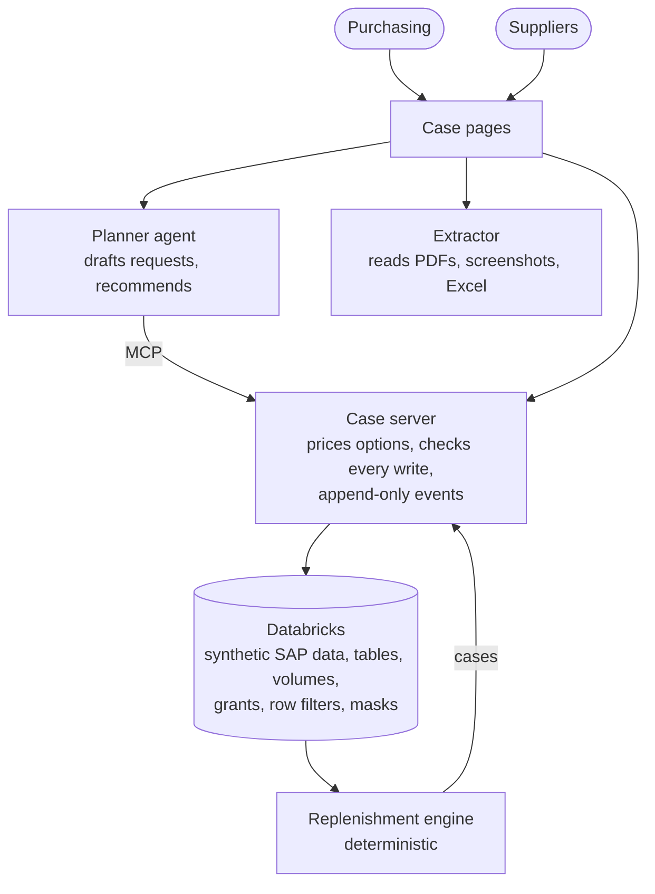

# SouthNorth Solutions — Verified Supply-Planning Agent

[](https://github.com/ZixuanXu0116/southnorth-supply-planning-agent/actions/workflows/ci.yml)

A supply-planning copilot on synthetic SAP-shaped data: a deterministic engine flags parts that will run short, AI agents prepare each case (the supplier request, the supplier's quotes read from any file, options priced with their stock-out risk, a ranked recommendation), and people make every decision.

> This repo mostly shows recommendations. At work I also build chat agents for purchasing and for suppliers on the same kind of semantic layer, knowledge base and harness, every answer traced and logged, to support decisions with more tailored information. I have not rebuilt that part here yet.

## How it works



1. The engine opens a case when projected stock falls short and dates its options (order, expedite, transfer) from today.
2. The planner agent drafts the supplier request; purchasing approves it with a mandate (latest arrival, surcharge and freight ceilings).
3. The supplier answers with the request sheet (read by code) or its own PDF, screenshot, or Excel (read by the extractor into a draft that purchasing confirms field by field).
4. The case server prices each quote: coverage, stock-out risk from a demand model, cost against the standard price, expected spend, mandate checks; it ranks them by expected cost.
5. The planner recommends one and explains the trade-off; a line written by the server states the recommended option's facts. Purchasing decides among the quotes or doing nothing, and the system hands off to logistics.

**Design in brief**

- **Numbers come from code, not the model.** The planner reads, compares, and explains; every figure it cites comes from a tool, and the case server refuses a write whose ids or order do not match its own evaluation.
- **The loop is thin and visible.** A TypeScript harness on PI's agent core: a fixed prompt, a tool set chosen per task, hooks before every tool call (one write per task, alone in its turn; budgets), and a trace of every turn.
- **Isolation.** Python tools run as MCP servers in their own processes with only their own credentials; the model's key never reaches them. Supplier text and documents are data, never instructions.
- **Measured change.** Every fix starts from a traced failure (a failure card), is replayed before and after, and stays as a regression test.

**Processes and boundaries**


Technical details: [`docs/TECHNICAL.md`](docs/TECHNICAL.md) · decisions: [`docs/decisions/`](docs/decisions/).

## How it is evaluated

- **Decision quality (regret).** Each decision is priced afterwards on the demand that actually followed: an option costs its own cost (surcharge, freight, price difference, order and holding cost) plus a line-down cost for each day the stock would have been short. The cheapest option in hindsight is the oracle:

  `regret = cost of the chosen option − cost of the hindsight-cheapest option`

- **Trace soundness.** Every run leaves a trace of its turns and tool calls. A sample of traces is graded by an LLM judge against the steps a sound solution takes (read the case before writing, rank before recommending, cite the server's evaluation ids, end with one write on its own), to catch a right answer reached the wrong way (`snm-evals trace-judge`).
- **Supplier documents (field accuracy).** Documents with known answers (PDFs, screenshots, scans, the supplier's own Excel): `field accuracy = fields read correctly / fields in the document`.

## Try it locally

No keys or cloud account needed for the case pages (Python 3.11 with `uv`; macOS or Linux, WSL on Windows):

```bash
git clone https://github.com/ZixuanXu0116/southnorth-supply-planning-agent && cd southnorth-supply-planning-agent
uv sync
uv run snm-data generate --profile small    # synthetic SAP-shaped data, about a minute
uv run snm-data plan --from-profile small   # the engine opens the cases
uv run snm-web serve                        # open http://127.0.0.1:8000 and choose Purchasing
```

The agents also need Node 22 (`npm ci && npm run build -w harness`) and an Anthropic key (`SNM_ANTHROPIC_API_KEY`, `SNM_MODEL_MAIN`). Databricks App deployment: [`docs/DEPLOYMENT.md`](docs/DEPLOYMENT.md).

## Status (2026-11-02)

- **Built:** engine, case store, purchasing and supplier pages; the planner agent with a verifier sub-agent; supplier replies read from PDFs, screenshots and Excel; the data agent; governance; evaluations (regret, trace soundness, field accuracy); each MCP server in its own process; deployed as a Databricks App.
- **In progress:** the intake agent (its case-server side is built); an improvement loop that turns failures into reviewed fixes.
- **Planned:** questions inside a case thread for purchasing and suppliers; supplier replies by email.

## How this was built

I designed the core ideas, the system architecture, and the whole pipeline and workflow; Claude Code wrote the code.

More: [technical notes](docs/TECHNICAL.md) · [status log](docs/STATUS.md) · [design](docs/PROPOSAL.md) · [developer guide](docs/DEVELOPMENT.md) · [role play](docs/ROLE_PLAY.md)
