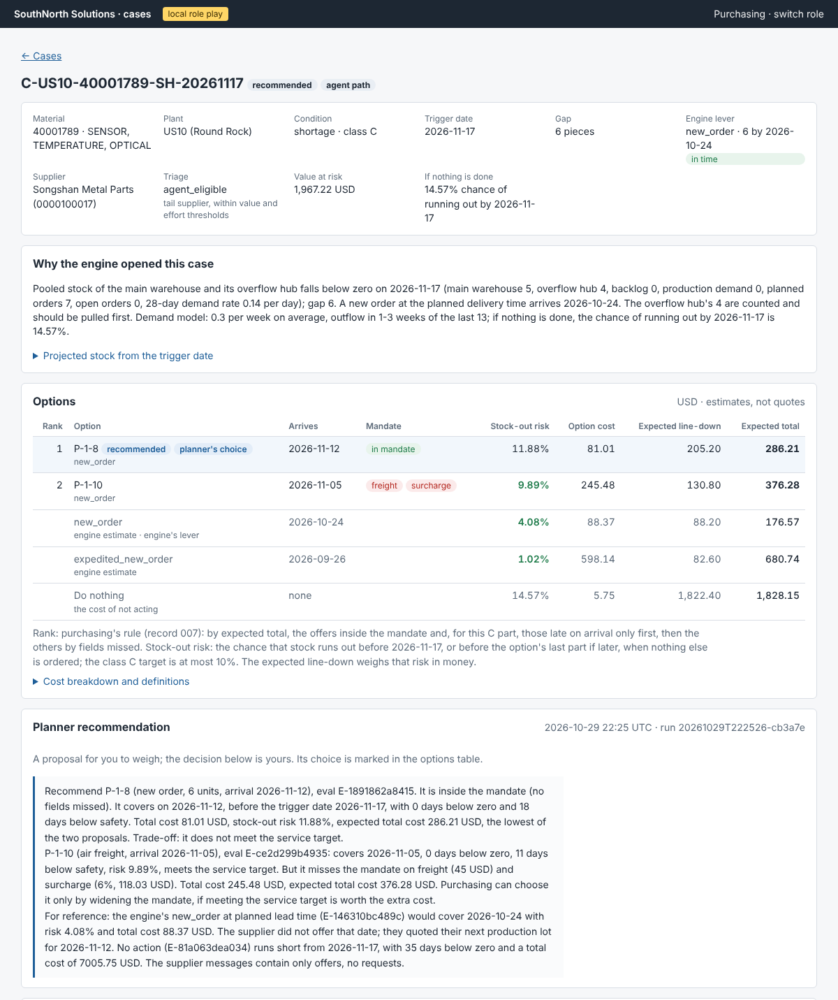
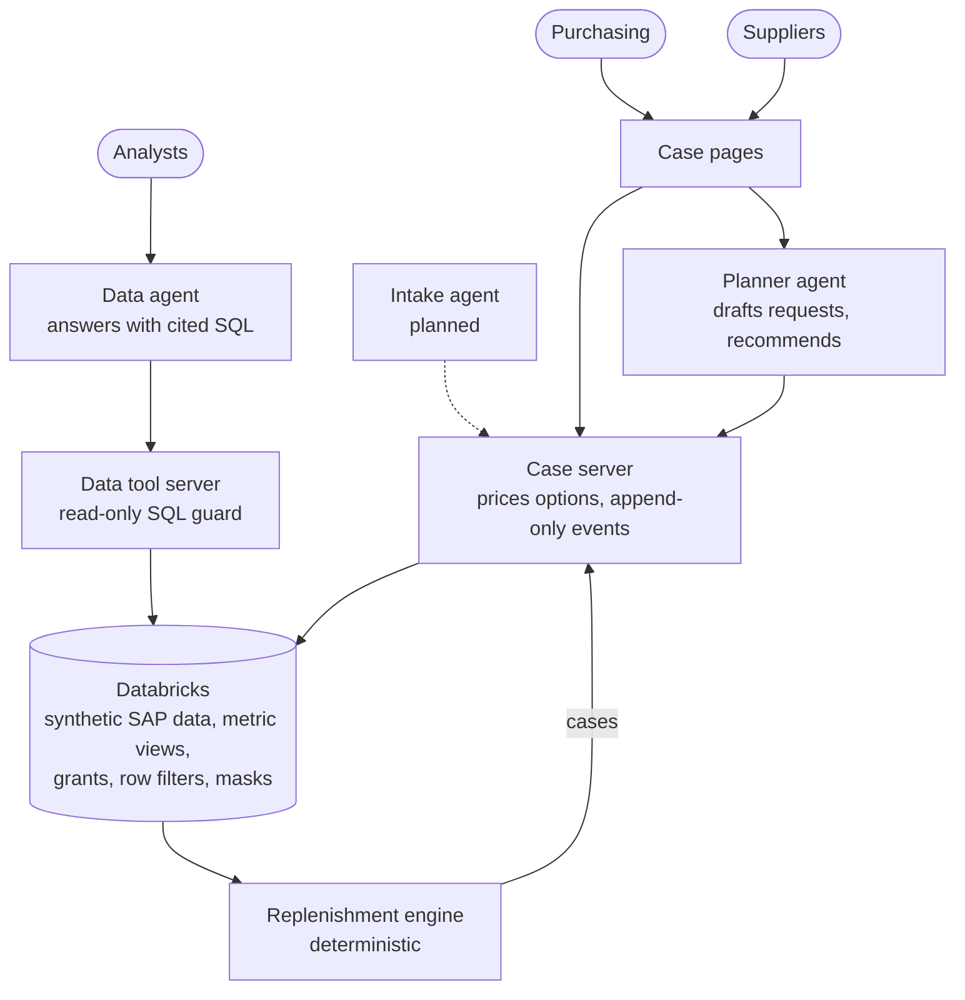
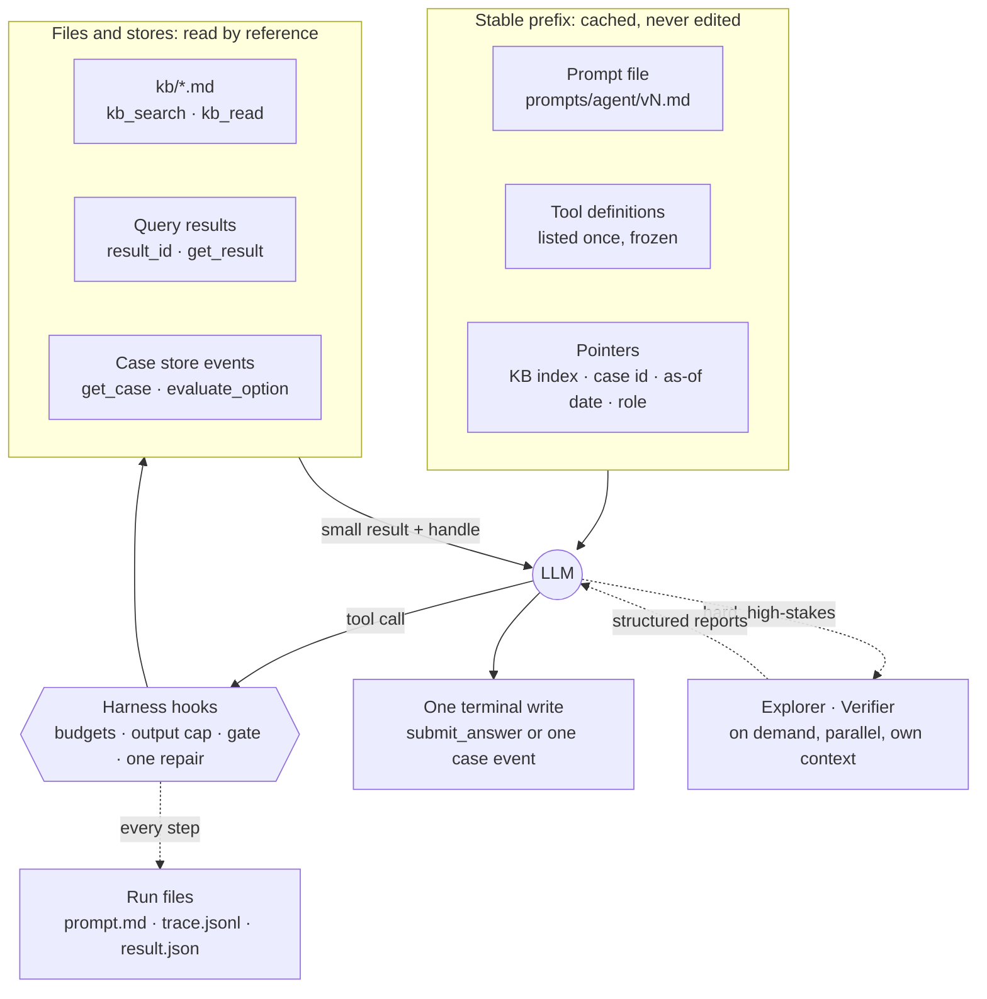

# SouthNorth Solutions — Verified Supply-Planning Agent

[](https://github.com/ZixuanXu0116/southnorth-supply-planning-agent/actions/workflows/ci.yml)

A supply-planning copilot on synthetic SAP-shaped data: a deterministic engine flags parts that will run short, AI agents prepare each case (the supplier request, options priced with their stock-out risk, a ranked recommendation), and people make every decision.

> This repo mostly shows recommendations. At work I also build chat agents for purchasing and for suppliers on the same kind of semantic layer, knowledge base and harness, every answer traced and logged, to support decisions with more tailored information. I have not rebuilt that part here yet.



## How it works



- **The engine flags, the agents prepare, people decide.** The planner agent drafts the supplier request and recommends an option with its reasons; no agent can send, order, or accept a price.
- **Numbers come from tools, not the model.** The engine and the case server compute costs and stock-out risks, and the planner writes no SQL. The data agent asks governed metric views, whose SQL the server writes; only for a question no metric covers does it write its own read-only SQL, which is checked, run under the role's identity, and shown with the answer ([example](docs/images/question-page.png)).
- **The intake agent is a careful messenger.** Its own context and permissions (one case's outward fields, no data): it carries the request out and the offers back, never commits or judges, and escalates anything uncertain to the planner and purchasing.

## Design in brief



- **Context:** a small, stable prefix (prompt file, frozen tool set, pointers); knowledge, query results, and case state stay in files and stores, read by reference.
- **Caching:** the prefix is byte-stable and the transcript append-only, so 85–91 % of input tokens are read from the cache.
- **Memory:** sessions are short, cases remember in an append-only event store, and knowledge changes only through reviewed failure cards; agents never write their own memory.
- **Loop:** the harness, on PI's agent core, owns budgets, one terminal write, a faithfulness gate on every number, and one repair prompt.
- **Compaction last:** small outputs at the source, overflow saved to files behind a pointer, and a fresh session from a handoff document only as the last resort.
- **Sub-agents on demand:** a verifier checks a planner recommendation in its own context, only when it departs from purchasing's order, misses its service target, or is high value (built, being measured); an explorer for unfamiliar data is designed.
- **Isolation:** TypeScript harness; Python tools over MCP in separate processes, each with only its own credentials; no agent can run code or write data outside the case store.

Technical details: [`docs/TECHNICAL.md`](docs/TECHNICAL.md).

## Try it locally

No keys or cloud account needed for the case pages (Python 3.11 with `uv`; macOS or Linux, WSL on Windows):

```bash
git clone https://github.com/ZixuanXu0116/southnorth-supply-planning-agent && cd southnorth-supply-planning-agent
uv sync
uv run snm-data generate --profile small    # synthetic SAP-shaped data, about a minute
uv run snm-data plan --from-profile small   # the engine opens the cases
uv run snm-web serve                        # open http://127.0.0.1:8000 and choose Purchasing
```

The planner buttons also need Node 22 (`npm ci && npm run build -w harness`) and an Anthropic key (`SNM_ANTHROPIC_API_KEY`, `SNM_MODEL_MAIN`); the data agent needs a Databricks workspace ([developer guide](docs/DEVELOPMENT.md)). This is a design and workflow demo that runs locally, not a hosted service.

## Status (2026-10-29)

- **Built:** engine, case store, purchasing and supplier pages, planner agent, data agent, governance, evaluation, spill files, and thread handoffs; runs locally and on Databricks Free Edition.
- **In progress:** the intake agent (its case-server side is built); an improvement loop that turns failures into reviewed fixes; the planner's verifier (built, being measured).
- **Planned:** questions inside a case thread for purchasing and suppliers; explorer.

## How this was built

I designed the core ideas, the system architecture, and the whole pipeline and workflow; Claude Code wrote the code.

More: [technical notes](docs/TECHNICAL.md) · [status log](docs/STATUS.md) · [design](docs/PROPOSAL.md) · [developer guide](docs/DEVELOPMENT.md) · [role play](docs/ROLE_PLAY.md)
