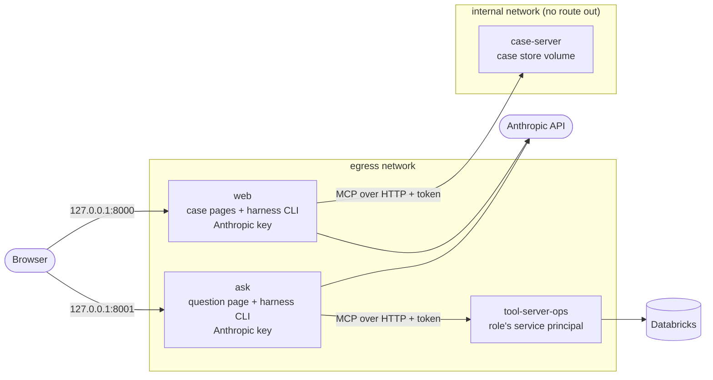

# Deployment

Two ways to run the system: as one process tree on your machine (`docs/DEVELOPMENT.md`; the harness starts each MCP server as its child over stdio), or with each server in its own container (decision record [010](decisions/010-one-server-per-container.md)), described here.

## One server per container



The `tool-server-ops`, `web`, and `ask` containers are on both networks; `case-server` is on the internal one only.

### Run it

From the repository root, with Docker and the settings you use for local runs loaded in your shell (`set -a; source ~/.config/snm/env; set +a`), and a local planning run (`uv run snm-data plan --from-profile small`):

```bash
uv run python deploy/make_env.py
```

```bash
docker compose -f deploy/compose.yaml up --build
```

Then open http://127.0.0.1:8000 (case pages) and http://127.0.0.1:8001 (question page). `make_env.py` writes one settings file per container under `deploy/env/` (git-ignored, mode 600) and generates the two service tokens; it never prints a value. The planning run defaults to `out/planning/2026-09-21`; set `SNM_PLANNING_RUN` to use another.

Check that every container reaches the server it calls (no model call, no data read):

```bash
docker compose -f deploy/compose.yaml exec web node harness/dist/cli/ping.js
```

```bash
docker compose -f deploy/compose.yaml exec ask node harness/dist/cli/ping.js
```

### What each container holds

| Container | Settings | Calls |
|---|---|---|
| `tool-server-ops` | `DATABRICKS_HOST`, `DATABRICKS_WAREHOUSE_ID`, the role's `DATABRICKS_CLIENT_ID` / `DATABRICKS_CLIENT_SECRET`, `SNM_SERVICE_TOKEN` | Databricks |
| `case-server` | `SNM_SERVICE_TOKEN`; the case store volume, the planning run (read-only) | nothing |
| `web` | `SNM_ANTHROPIC_API_KEY`, the models, `SNM_CASE_SERVER_TOKEN`, `SNM_CASE_SERVER_URL` | the case server, the Anthropic API |
| `ask` | `SNM_ANTHROPIC_API_KEY`, the models, `SNM_TOOL_SERVER_TOKEN`, `SNM_TOOL_SERVER_URL_OPS_ANALYST_GLOBAL` | the tool server, the Anthropic API |

The harness runs inside `web` and `ask` as the pages' subprocess; with a server URL set it connects over Streamable HTTP, without one it starts the server as a child over stdio, as on a laptop.

### Behind a TLS-inspecting proxy

Build with the proxy and its CA as a build secret (never stored in a layer):

```bash
docker build --network host --build-arg HTTPS_PROXY="$HTTPS_PROXY" --secret id=extra_ca,src=/path/to/ca-bundle.crt -f deploy/Dockerfile --target app -t snm/app:dev .
```

The images come from mirrors of the official ones (`public.ecr.aws/docker/library/...`, `ghcr.io/astral-sh/uv`), which avoids Docker Hub's anonymous pull limit.

### How it was checked (2026-11-01)

See decision record 010, Acceptance: images built, servers healthy, `ping` from both pages, the settings in each container listed by name, 401 without the token, a real planner task writing through the containerized case server into the shared store and shown on the case page, and no route out from the case server.

## Databricks App

One app, `snm-cases`, holds the case pages, the harness, and both MCP servers as the harness's children over stdio (Free Edition allows three apps, each stopped after 24 hours and restarted at will; the runtime is Ubuntu 22.04 with Node 22 and Python 3.11). The pages read the lakehouse (`snm-web serve --databricks`); the planner's case server reads the curated planning tables and appends to the `cases` schema as the app's own service principal, which governance makes the `case_writer` role (cost access, writes to `cases` only). The Anthropic key comes from the secret `snm/anthropic_api_key`, which the owner stores; it never passes through the deployment script. A probe app (2026-11-01, deleted) showed that an app reaches the Anthropic API from Free Edition and that the stored key works.

With the owner's workspace settings and the model settings loaded:

```bash
uv run python deploy/databricks/deploy.py create
```

```bash
uv run python deploy/databricks/deploy.py grant
```

```bash
uv run python deploy/databricks/deploy.py deploy
```

`create` makes the app with two resources (the secret, read; the SQL warehouse, can use) and prints its service principal. `grant` runs `snm-data govern` with `SNM_PRINCIPAL_CASE_WRITER` set to that principal (the `snm_case_writer` group, the grants of the contracts that name `case_writer`, the commercial masks that admit the group) and grants the attachments volume. `deploy` stages the source (`out/databricks-app/`: the packages, the harness source, prompts, KB, contracts, a `requirements.txt` from `uv export`, and `app.yaml` with the model settings), uploads it to the workspace, and deploys it; the app installs the packages and builds the harness itself.

Deployed 2026-11-01: `create`, `grant` (governance drift none afterwards), and `deploy` ("App started successfully"); the owner opens the app from the workspace (Compute, Apps, `snm-cases`), and restarts it there after the 24-hour stop. The pages' writes on behalf of people are made as the app's principal too; per-user writes would use the app's on-behalf-of-user authorization.

Latency (2026-11-01, after the first deployment showed every step slower than local): the case server now caches what does not change within an engine run (evaluations per case snapshot and option, proposal reads per case state, supply positions, cost parameters; pricing a case's options went from 9.6 s to 2.9 s cold and 0.6 s warm), and the app starts the planner's case server once beside the pages on localhost over Streamable HTTP (`--case-server-port`, a token generated at start) instead of one per planner run (two planner-style sessions against the lakehouse: 5.6 s, then 1.5 s).

Run records (2026-11-02): the pages write the access log and each agent run's trace under `/tmp/snm-runs`, which the app loses when it stops; a background thread copies every new or changed file to the volume `snm.cases.runs`, one folder per app start (`app-<UTC start>/access.jsonl`, `app-<UTC start>/agents/<run>/trace.jsonl`), every 20 seconds, right after each planner run, and when the app stops (`--runs-volume`, `apps/web/src/snm_web/mirror.py`). `snm-cases deploy` creates the volume; `grant` gives the app's principal read and write on it.

The case server's day: engine levers are dated from today (the snapshot's as-of date plus the days since), so a case acted on weeks after its snapshot never shows a past arrival as achievable; the app uses the wall clock, while a frozen synthetic world (an eval batch, `snm-sim`) pins today to its as-of date (`SNM_CASE_TODAY`). The resident case server keeps its planning reads until a new engine run is published, which it checks at most once a minute (one small query on `curated.replenishment_case`).

Supplier documents (2026-11-02): a supplier's own PDF, screenshot, or Excel is read by the extractor (`harness/dist/cli/extract.js`, the model `SNM_MODEL_EXTRACTOR`, appended to `app.yaml` by `deploy.py` like the other model settings) into a draft that purchasing confirms on the case page; PDFs are rendered with `pypdfium2` (a wheel, no system package).

MLflow (2026-11-02): each agent run of the app (planner, extractor) is uploaded as one MLflow trace, rebuilt from its `trace.jsonl` as evaluation runs are, to the experiment `SNM_MLFLOW_APP_EXPERIMENT` (default `/Shared/snm-workflow/app`, since 2026-11-05; before, `/Shared/snm-app-traces`), in a background thread, tagged with the app start (`batch` = `app-<UTC time>`, the runs mirror's folder); the experiment keeps its trace data in the runs volume (`dbfs:/Volumes/snm/cases/runs/mlflow-traces/workflow-app`, `SNM_MLFLOW_APP_ARTIFACTS`), written through the workspace's Files API, because an app's outbound connection to the storage host of MLflow's default trace store is refused (found on the first deployment, 2026-11-02); at start the app writes one `app_start` trace, which shows that its principal can write there. Every upload and every failure is a line in the access log (`action` `mlflow_trace`). Local pages do the same with `snm-web serve --mlflow`. The app's runs from before 2026-11-05 were uploaded once from the volume with `snm-evals mlflow-upload-app-runs`, each tagged with the first app start whose folder holds it.

### Where the traces are

| Runs | MLflow experiment | Raw files |
|---|---|---|
| Data agent evaluation batches | `snm-agent-evals` in the uploading user's folder | `runs/evals/<batch>/` where the batch ran |
| Workflow evaluation batches (planner, extractor) | `/Shared/snm-workflow/evals`: one run per batch, one trace per agent run | `runs/evals/<batch>/` where the batch ran; a copy of the batches of 2026-11-05 in `/Volumes/snm/cases/runs/eval-backup-20261105/` |
| App agent runs | `/Shared/snm-workflow/app`: one trace per agent run | `/Volumes/snm/cases/runs/app-<start>/agents/<run>/` |

Both workflow experiments keep their trace data under `/Volumes/snm/cases/runs/mlflow-traces/`. Filter a workflow experiment's traces by `agent`, `task`, `case_id`, `status`, `source`, `batch`, `prompt_version`, or `model`.

Not yet in the app: the question page and the data agent (its tool server needs a role's service principal of its own).

## Operations dashboard and uptime check

The workflow's daily numbers live in the schema `snm.ops` (contracts in `data_contracts/ops/`; the agents never read it): `agent_runs` (one row per run: outcome, latency, cost, tokens, refused writes, whether its trace passed every code check, the case's state after it), `trace_checks` (one row per run and check, and the LLM judge's verdict where one was made), `decisions` (each decision with the recommendation it was compared with and whether it followed it), `documents` (each confirmed supplier document with the fields purchasing changed), and `uptime_checks`. Every row carries `source`: `app`, `eval`, or `demo` (a generated example set for every table, four weeks long).

```bash
uv run python deploy/databricks/ops_deploy.py tables       # schema and tables
uv run snm-evals ops-daily --evals --demo                  # load the real rows, and write the demo set again
uv run python deploy/databricks/ops_deploy.py bundle       # upload the job scripts and their modules
uv run python deploy/databricks/ops_deploy.py jobs         # snm-ops-daily (daily, 10:17 UTC) and snm-uptime-check (paused)
uv run python deploy/databricks/ops_deploy.py dashboard    # "Replenishment workflow operations", published
uv run python deploy/databricks/ops_deploy.py recount      # the cards' SQL against snm_evals.ops.cards, same rows
```

- **The daily job** (`snm-ops-daily`, serverless, as the owner) adds the app's new agent runs from the runs volume, their code checks, and the case store's new decisions and documents; a second run adds nothing. It checks in code only: the LLM judge needs the harness and the Anthropic key, which stay out of Databricks jobs, so `snm-evals ops-daily --judge-sample N` judges N new runs where the harness runs. Evaluation batches are loaded with `--evals` from the machine that ran them.
- **The dashboard** shows the demo rows only: it demonstrates what is measured, and the real rows stay in the tables. It has filters for the date range, the agent and task, and the case; the cards on top follow them: acceptance rate, extractor accuracy, trace-check pass rate, refusal rate, error rate, uptime, latency and cost (p50 and p95), total cost, cost per case. Below: the rates, latency, and cost by day, the distributions of latency and cost, and the cost of each case. The definitions are in `snm_evals.ops.cards`, and `recount` checks that the dashboard's SQL gives the same values.
- **The uptime check** (`snm-uptime-check`, every 10 minutes, **paused** by default) reads the app's state and the age of `heartbeat.json`, which the app writes to the runs volume every minute, writes one row to `snm.ops.uptime_checks`, and starts the app when it is stopped (or redeploys it when it runs with no heartbeat for 3 minutes). Turn it on for a demo day and off after: `uv run python deploy/databricks/ops_deploy.py uptime on|off`. While it runs, the app stays up.
