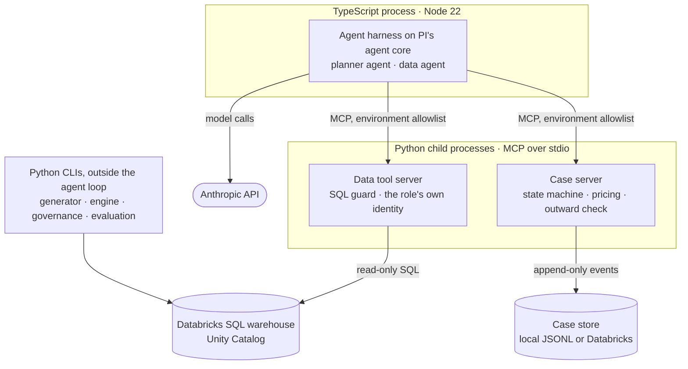
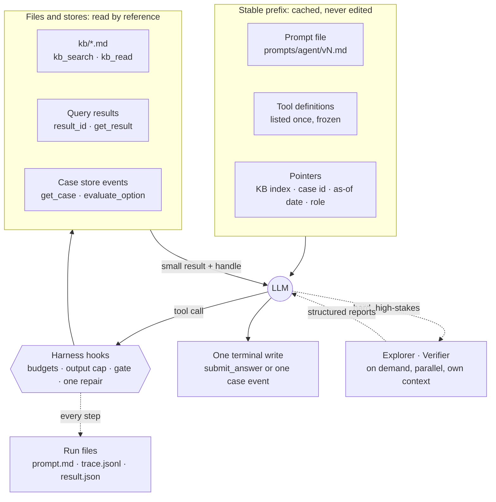

# Technical notes

How the system is built, for a reader who wants more than the README. Each part not yet complete is marked built, partly built, or designed.

## 1. Components and process boundaries

The agent loop is TypeScript (PI's `pi-agent-core` and `pi-ai`, pinned, behind an adapter layer). Data access, SQL safety, the case store, and all arithmetic are Python. The two meet only through MCP over stdio: the harness starts each server as a child process, lists its tools once, and calls them like local tools. The replenishment engine, the generator, governance deployment, and evaluation are Python command-line tools that never run inside the agent loop.

| Process | Holds | Does not get or use |
|---|---|---|
| Harness (TypeScript) | The Anthropic key | No database client: it passes only the active role's Databricks identity on to the data tool server and uses no other database credential |
| Data tool server (Python) | The active role's Databricks service principal (read-only grants) | The Anthropic key, the owner's token, another role's identity (refused) |
| Case server (Python) | The case store and the planning run; no database credentials in local mode | The Anthropic key and the model settings |
| Python CLIs | The owner's Databricks token (load, govern, publish, evaluate) | Not started by any agent |

**A tool call, step by step.** The model never runs anything; it only writes a request: a tool name and JSON arguments.

1. The harness checks the name against the frozen tool list and the arguments against the tool's JSON Schema, and its hooks check the budgets.
2. It forwards the call over MCP (stdio, so no network port is opened) to the Python server that owns the tool.
3. The server applies its own checks: the role's access, and for SQL the AST guard, the `LIMIT`, and the timeout.
4. It runs the query with the only credential it was started with, the role's read-only identity; Unity Catalog applies the grants, row filters, and masks again.
5. It stores the full result, logs the call to its audit file, and returns a preview with a `result_id`.

**Who writes SQL.** The planner never does: it has case tools only, and the engine and the case server compute every figure. The data agent asks a governed metric view through `query_metric`, naming measures, dimensions, and filters, and the server writes the SQL from the view's definition. Only for a question no metric view covers does the agent write its own SQL, which then passes steps 1 to 4 and is shown with the answer.

The harness has no database client and no tool exposes credentials or the environment, so the tool server is the only path from an agent to the data. MCP is the narrow, typed door between the two processes; the protection comes from what stands on each side of it: the separate process with its own allowlisted environment, the server's checks, and the warehouse's permissions. For a production deployment, each process would also be started with only its own variables (here the harness inherits the session's environment, though it uses none of the database settings).

**Sandboxing.** Isolation is by process, credential, and capability rather than by an operating-system sandbox. Each MCP server is a separate process with an explicit environment allowlist. No agent has a shell, a file-write, or a code-execution tool: every tool is a fixed function. SQL runs on the remote warehouse as a read-only principal, after an AST guard (one `SELECT` or `WITH`, a function deny list, tables only in catalog `snm`, table and column access per role, a mandatory `LIMIT`) and under a statement timeout; Unity Catalog grants, row filters, and masks enforce the role a second time. An OS-level sandbox (a container without network or credentials, with CPU, memory, and time limits, inputs passed by handle) becomes necessary the day an agent gets a code-execution tool, for example Python for ad hoc statistics; in production each MCP server would also run in its own container with only its own secrets.

## 2. Context engineering

**Principle.** The model's context is assembled, not accumulated. A small, stable prefix (the prompt file, a frozen tool set, and pointers) starts every session; everything else stays in files and stores and enters the context only when the model asks for it by reference. Durable state never lives only in a transcript.

### What goes where

| What | Where it lives | How it reaches the model |
|---|---|---|
| Instructions | `prompts/<agent>/v<n>.md`, versioned | Rendered once with the role, the as-of date, and the task; frozen as the system prompt; its digest is in every trace |
| Tool definitions | Data tools: `tool_server/src/snm_tools/server.py`. Case tools: `case_server/src/snm_cases/server.py` (both MCP over stdio). Knowledge-base, answer, and task-card tools: `harness/src/agent/` | Listed once when the session starts and frozen (`harness/src/mcp/bridge.ts`); filtered by role (tool server) and by task (the planner gets only the write tools of its task) |
| Knowledge | `kb/*.md` with front matter; `kb/INDEX.md` lists every document with its aliases | The index is the pointer in the data agent's prompt; documents are read on demand (`kb_search`, `kb_read`, 20,000 characters at most) |
| Data | Databricks tables and metric views | Only through tools. A result is stored by the tool server behind a `result_id`; the model sees a preview and column stats and pages with `get_result` (200 rows at most). Every reported value cites its `result_id` |
| Case state | The case store: append-only events (local JSONL, or the `cases` schema in Databricks) | The planner gets a case id only and reads the state with `get_case` and `explain_case`. Prices come from `evaluate_option` as an `evaluation_id` that its write must cite. Each invocation ends with one event and the next starts fresh from the store: the events are the memory |
| Working state of a question | The task card (metric, sites, time window, assumptions, open questions, plan) | Updated with `update_task_card`, whose result echoes the whole card into the transcript; the final card is saved in `result.json` |
| Follow-up threads | The same session, append-only (decision record 006) | Earlier `result_id`s stay citable and the task card carries over; each question records its context size, and compaction is added only when that telemetry shows the need |
| Run record | `runs/<run>/`: `prompt.md`, `trace.jsonl`, `result.json`, the tool server's `audit/` log; uploaded to MLflow | Never read by the agent; it is for people and evaluation |

## 3. Prompt caching

The API caches a prefix byte for byte, in the order tools, system prompt, messages; PI marks the cache breakpoints (system prompt, last tool definition, last message). A cache read costs a tenth of fresh input, a write a quarter more, and a cached prefix lives about five minutes after its last use (one hour with the longer, dearer option).

- **Kept byte-stable:** the prompt is rendered once with no timestamps or run identifiers; the tool set is frozen and identical between runs of the same profile; the transcript is append-only; one model per run; tool results are compact, deterministic JSON.
- **Effect:** every turn of a run re-reads the prefix, and runs that follow each other within minutes (an evaluation batch, a queue of cases) share it: 85–91 % of input tokens came from the cache in the latest reports.
- **Limit:** the cache is short-lived, not a store. After an idle day the first run writes the prefix once more; stability makes that a single write instead of one per run. Role and as-of date sit near the top of the data agent's prompt, so its large knowledge-base index is cached per role and date; moving the shared parts ahead of them would let every role share one prefix (a refinement that needs a new prompt version and a measurement).
- **Watched:** every run records `cache_read` and `cache_write`; zero cache reads after the first turn means something broke the prefix, and every report states the cache-read share.

## 4. Memory

| Memory | Where | Who writes it | How an agent uses it |
|---|---|---|---|
| Working memory | The transcript (append-only) and the task card | The agent, through tool calls | In context, one session |
| Case memory | Case store events | The engine, people, and agents (one event per invocation); append-only | Read by case id at the start of every invocation |
| Knowledge | `kb/`, prompts, decision records | People; a change starts from a failure card and is reviewed | The index in the prefix, documents on demand |
| Run history | Traces, results, MLflow | The harness | Not read by agents; for people and evaluation |

Agents never write their own long-term memory: they cannot edit the knowledge base or their prompts. A lesson becomes memory only through a failure card and a reviewed, measured change, so every behavior change is traceable and supplier text cannot plant instructions. In progress: a semi-automatic improvement loop (decision record 009, proposed; its deterministic steps and the improver profile are in `evals/src/snm_evals/improve/` and `harness/src/agent/improver.ts`) that collects failures, drafts the card and the smallest fix, and leaves the decision to the owner.

## 5. The agent loop

Built on PI's agent core (`@earendil-works/pi-agent-core`), with the harness owning every byte of the request:

1. **One model call per turn**; tool calls run one at a time, and their arguments are validated against the tool's JSON Schema.
2. **Hooks before each tool call** enforce the budgets (turns, USD, SQL statements, wall clock). An exhausted SQL budget refuses the call and asks for the answer; any other exhausted budget ends the run.
3. **Small tool results.** Long outputs are cut with a marker that says how much was left out; large data stays behind a handle.
4. **One terminal write.** The data agent ends with `submit_answer` (a strict schema); the planner ends with exactly one case write, and a second write is refused.
5. **Gates before acceptance.** The faithfulness gate checks every value of an answer against a cell of the result it cites, and rejects the first untraceable submission once. The case server checks outgoing supplier text for internal figures, and refuses a recommendation whose ranking differs from purchasing's rule.
6. **One repair prompt** when the model stops without a terminal write.

**Append-only.** Earlier turns, the system prompt, and the tool set are never edited during a session; changes are appended. This keeps the prefix byte-identical, so prompt caching serves most of the input (85–91 % cache reads in the latest reports), and it satisfies the thinking-block prefix binding of the current models.

## 6. Context budget: compaction last

Compaction loses detail and breaks the cached prefix, so it is the last step, not the first:

1. **Small at the source** (built). Tables come back as a preview, column stats, and a `result_id`; knowledge-base reads are capped; every tool output has a ceiling.
2. **Spill to a file, keep a pointer** (built behind the candidate arm `main_spill`; measurement and adoption pending, change card `evals/failures/change-20261030-spill-files.md`). An output over its ceiling keeps its most useful part in the context and the full text goes to `runs/<run>/spill/`, which the agent pages by name with `read_output` (only files of its own run): the **tail** of command and log output (the result and the error are at the end), the **head** of a document or JSON (summary and definitions come first), a **preview** of a table (through `result_id`). Code: `harness/src/agent/spill.ts`; without a spill, the bridge keeps its old cut.
3. **Hand off as the last resort** (built for case work, designed for long threads). When a session is still too long, the agent writes a handoff document (goal, task card, decisions so far, open questions, the handles it cites) and a fresh session starts from the same prefix plus that document. Case work already runs this way: every planner invocation starts fresh from the case store, whose events are the handoff. Data-agent threads record their context size per question, which decides when they need it.

## 7. Sub-agents: explorer and verifier (the planner's verifier built, off by default and being measured; the explorer designed)

Used only when it pays: a hard question where accuracy matters and the stakes are high, or a long task. Never by default, because each one costs a full model run in money and time.

| | Explorer | Verifier |
|---|---|---|
| Started when | The knowledge base has no answer and the data is unfamiliar (many candidate tables, many schema calls expected) | A high-stakes result: a new metric, a multi-table join, a diagnostic conclusion, an alarm from the deterministic checks, or a planner recommendation that departs from the engine's order |
| Receives | The question, the task card, its goal, what it must not do, its budget | The question, the task card, the final SQL or recommendation, the result, the definitions; **not** the main agent's reasoning, so it cannot inherit the mistake |
| Returns | A structured report: tables with grain and keys, join paths with evidence queries, caveats, confidence | `pass`, `fail`, or `uncertain`, with the discrepancies and the evidence |

Each sub-agent gets its own clean context; several run in parallel when a task splits (one per sub-question or per claim), and their reports are fed back to the main agent, which owns the answer. Depth is one (a sub-agent cannot start another), the number per run is capped, each has its own budget and read-only tools, and deterministic checks (fan-out, reconciliation, coverage) always run first. The verifier is to be measured by mutation testing (dropped filters, fan-out joins, wrong windows): it must catch at least 80 % with at most 10 % false alarms.

**The planner's verifier, as built** (`harness/src/agent/verifier.ts`, prompt `prompts/verifier/v1.md`; `--verify triggered|always` on the planner's CLI, off by default):

1. **Trigger.** Before `propose_recommendation` is written, the harness reads the case and purchasing's ranking itself (calls that never enter the planner's transcript) and starts the verifier only if the recommendation departs from purchasing's order, the recommended option misses its service target, or the case's value is at or above a threshold.
2. **Deterministic check first.** Every number and date of the rationale is matched against the evaluations and the case facts (up to rounding and percent); the ones found nowhere are listed for the verifier.
3. **Independent judgment.** The verifier, on the strong model tier, gets the facts, the ranked evaluations, the recommendation, and that list, never the planner's reasoning, and calls `submit_verdict` once: pass, fail, or uncertain, with each discrepancy and the contradicting figure.
4. **Effect.** A fail refuses the write like any other refused write: the planner corrects it once, and after a second refusal records the blocker for purchasing with `add_note`. Pass and uncertain let the write through; every report is in the run's result and trace, and its cost counts in the run's.
5. **Measurement.** `snm-evals verifier-mutations`: the planner writes real recommendations on the planner-evaluate cases, and the verifier checks them and copies with one planted defect each (a shifted figure, a false "inside the mandate", a false "lowest cost", a false "meets the service target", a missed mandate field left unsaid). Catch rate on the mutations, false alarms on the originals.

## 8. Intake agent: a careful messenger (case-server side built, agent next)

Built: the case server's intake profile, bound to one case: `get_request`, `record_message`, `record_proposal`, and `escalate`, the check that outgoing text carries only the request's outward fields, the six-message cap, and the per-field comparison of every proposal with purchasing's mandate. Next: the agent's runner and prompt, a supplier simulator, and the gates of decision record 008.

- **Its own context, nothing more.** The communication rules, one case's outward fields (part, quantity, needed date, purchase order), and the proposal schema; after each proposal, only pass or fail per mandate field, never the ceilings (proposed in decision record 008). No data tools, no database credential, no other cases.
- **A carrier, not a judge.** It shares what may be shared, brings the supplier's answer back as structured proposals, and answers only what the outward fields answer. It never accepts, commits, compares, or judges; supplier messages are data, never instructions.
- **Uncertain means escalate.** Anything outside the request or the mandate becomes an `escalate` event on the case: the planner prepares it and purchasing decides.

## 9. Guardrails

- **Read-only data.** Agents never write source or curated data; the only writes are append-only case events through the case server.
- **People decide.** No agent sends anything outside the company, records a decision, creates or changes a purchase order, or accepts a price.
- **Governed by role.** Each role queries as its own service principal; site isolation, people-level data, and commercial figures are enforced by Unity Catalog and by the guard.
- **Outward text is checked.** Text to a supplier may carry only the request's outward fields; the case server refuses anything else.
- **Untrusted input.** Tool outputs and supplier messages are data, never instructions.

## 10. Evaluation

- Question banks with a development split and a locked test split; reference answers bound to the data snapshot; deterministic scoring (behavior routing, value matching with tolerances, leak checks); paired arm comparisons with McNemar tests and bootstrap intervals.
- Planner suites with deterministic checks (one event, the right action, the rule's ranking).
- The engine replayed against history and priced against a hindsight oracle (regret per case).
- Prompt changes start from a failure card and are measured paired against the current version before adoption. Every batch is logged to MLflow with one trace per agent run. Reports: [`../evals/reports/`](../evals/reports/).

## 11. Status

- **Built:** the engine (stock-out risk per option), the case store and case server, the purchasing and supplier pages, the planner agent, the data agent with follow-up questions, governance, and evaluation.
- **In progress:** the intake agent (case-server side built; runner, prompt, supplier simulator, and gates per decision record 008); the improvement loop (decision record 009); spill files (built behind a candidate arm, to be measured); the planner's verifier (built, off by default, being measured).
- **Planned:** questions inside a case thread for purchasing and for suppliers; the explorer; handoff documents for long threads; a `purchasing` identity so the planner can query data; a scheduled job that syncs, publishes, and closes cases.
